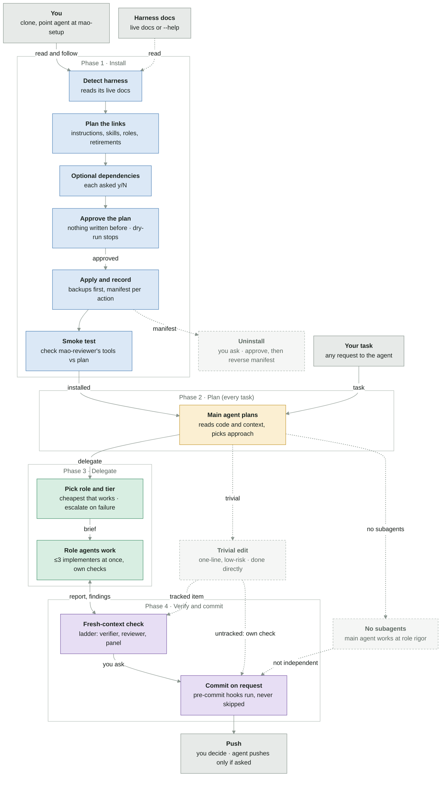
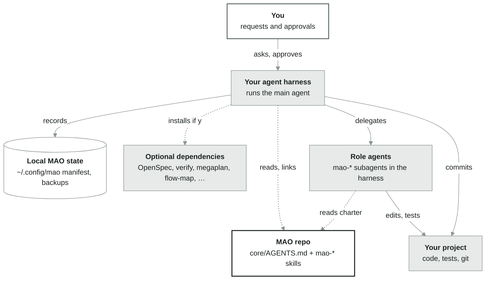
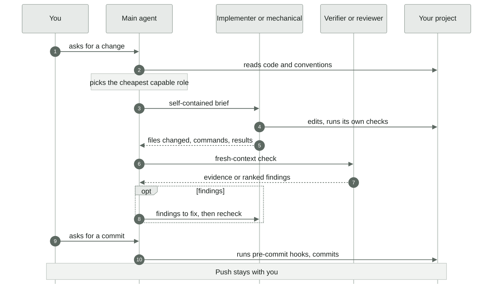

# Flow map — from clone to a verified commit

How MAO works end to end: you clone the repo and ask your agent to read and follow `core/skills/mao-setup/SKILL.md` (A); from then on every task you give the agent is planned, delegated to role agents, checked per the verification ladder, and committed only when you ask (B). Pushing stays with you. This is the largest flow in the repo; uninstall is drawn as a side path, and the repo's own ICM work stages (`stages/`; `starter/` is the template for other projects) are a separate flow not drawn here.

Renders on GitHub and in any Markdown viewer with Mermaid support.

> **Status:** Every step is described in the sources; nothing is missing. MAO is instructions, not code: each step is carried out by your agent following them. Tool limits are hard only where your harness can enforce them; elsewhere they are prompt-only, and `mao-setup` says which in its plan.
> Lines: solid = exists · red dashed or red band = missing · dotted = optional or read-only · "no code yet" (or "not described") box = missing stage · grey = outside the target · light grey dashed box = side path

## 1. What happens

| Phase | In one line |
|---|---|
| Install | Once per harness; re-run to update. Your agent reads its harness's live docs, plans every link and file, asks y/N per optional dependency, writes nothing until you approve, backs up and records each action, then smoke-tests one role agent. A failed check is reported as FAILURE, never passed; any plan change needs approval again. Uninstall (on request) shows a reverse plan of this harness's recorded actions and undoes them after approval; items another harness still uses are kept; anything altered since install is kept by default; retired items are not restored unless you opt in. |
| Plan | For each task the main agent reads the code and project context and chooses an approach. A one-line change it may do itself. Without subagent support it does the role work itself and never presents its own check as independent. |
| Delegate | It briefs the cheapest role that can do the work reliably (`mao-hard-implementer` only for hard, high-risk or failed work); implementers edit and run their own checks; every worker reports and never spawns workers. With no `mao-<role>` subagent installed, a generic subagent reads the role's charter. `mao-documenter` runs only when docs are requested or made inaccurate, once behavior is settled. |
| Verify and commit | Checks follow the verification ladder: a trivial, low-risk edit outside a tracked work item gets the implementer's own check; every other change is checked in a fresh context, never by the author — a verifier for any other change or any tracked item, plus a reviewer when it is significant or risky, plus an independent panel before a version is tagged; where rungs overlap, the highest applies, and a change to the ladder itself is checked under the base branch's ladder, at the significant rung or higher. Findings go back to the implementing role. The agent commits only when you ask, after the repo's pre-commit hooks pass (failures fixed, never bypassed); pushing is yours. |

## 2. Who talks to whom

You talk only to your agent. It reads MAO, links it into the harness, records what it did locally, and delegates to role agents that work in your project. Colors here only tell who is who.

## 3. The life of one task

## Where it lives

| Phase | Path |
|---|---|
| Install | `core/skills/mao-setup/SKILL.md`, `core/skills/mao-setup/manifest.md` |
| Plan | `core/AGENTS.md` (Main agent, Roles and tiers) |
| Delegate | `core/AGENTS.md` (Delegation), `core/skills/mao-<role>/SKILL.md` |
| Verify and commit | `core/AGENTS.md` (Delegation step 8, Committing), `docs/policies.md` (Verification ladder) |

Glossary: [docs/megaplan/glossary.md](docs/megaplan/glossary.md).

When the flow changes, the map changes in the same PR. To update, see what changed since the commit below.

Updated 2026-11-05 · multi-agent-orchestration docs/b12-ladder-changelog babaabc
